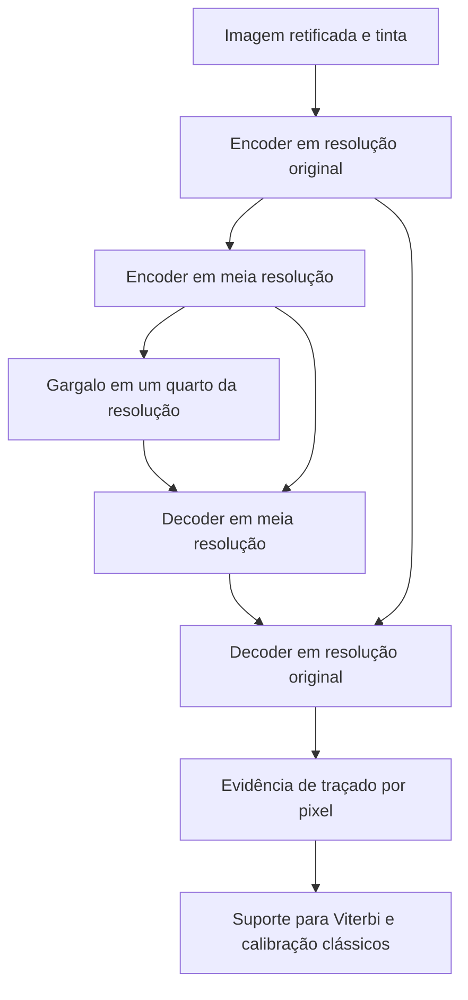

# U-Net com pesos programados para apoiar o digitalizador clássico

Este experimento implementa uma rede convolucional pequena com encoder, gargalo,
decoder e duas conexões de salto. Os pesos são escritos diretamente em Python.
Não há treino por gradientes, ajuste a pares imagem/máscara ou checkpoint
pré-treinado. A rede funciona como um programa de processamento de imagem.

O objetivo inicial é testar se evidências em várias escalas ajudam a recuperar
suporte fraco perto dos traçados já encontrados. O desempenho precisa ser
comparado com o método clássico antes de adotar esse auxílio por padrão.

## Relação com as referências

- [Sparks of Weight-Space Programming](https://rikiyat.github.io/blog/weight-space-programming/)
  descreve escrever e editar pesos diretamente, incluindo experimentos sem
  gradientes e outros com orçamento limitado de avaliações.
- [Interpretable Weight-Space Programming](https://www.alphaxiv.org/abs/2611.interpretable-weight-space-programming)
  e o [código dos autores](https://github.com/csinva/weight-space-programming-autoresearch)
  acrescentam hipóteses explícitas e refinamento pelo resultado de validação.

Aplicamos a ideia de compilar hipóteses legíveis em pesos. Este código não é uma
replicação dos experimentos dos autores e não demonstra que uma U-Net grande
possa competir com segmentadores treinados em ECG sem dados de treinamento.

## O que foi implementado

| Componente | Implementação |
|---|---|
| Entradas | Densidade de tinta clássica, escuridão neutra e máscara do papel |
| Encoder inicial | Convolução 5x5, 8 canais, ReLU |
| Duas reduções de escala | Average pooling 2x2 e convoluções 3x3 |
| Decoder | Duas ampliações por vizinho mais próximo, concatenação com os skips e convoluções 1x1 |
| Saída | Logit e sigmoide por pixel |
| Pesos | 2.057 posições, 96 valores não nulos, todos definidos pelo compilador |
| Regra de integração | Acrescentar suporte próximo à máscara clássica, exigindo tinta medida |
| Geometria do sinal | Calculada pelo código clássico com a densidade óptica original |

Os oito canais têm nomes: tinta, escuridão neutra, cristas horizontais, verticais,
duas diagonais, contraste local e papel. O canal do papel é propagado, mas tem
peso zero na saída nesta versão. O papel também mascara as duas entradas de tinta.
Os canais das escalas menores carregam médias espaciais. O decoder mistura essa
evidência com as cristas finas preservadas pelos skips.



O mapa de saída é uma pontuação de segmentação. A sigmoide não o transforma em
probabilidade calibrada de pertencer a um ECG.

## Uso

```bash
pip install -e '.[wsp,dev]'
python -m ecgdig exame.jpg --trace-support programmed-unet -o saida_unet
python -m ecgdig exame.jpg -o saida_classica
```

Para instalar PyTorch de CPU em Linux, pode-se instalá-lo antes do extra:

```bash
pip install torch --index-url https://download.pytorch.org/whl/cpu
pip install -e '.[wsp,dev]'
```

```python
from ecgdig import digitize, Config
from ecgdig.programmed_unet import ProgrammedSupport, ProgramSpec

# Usar os mesmos parâmetros de geometria nas duas variantes.
cfg = Config()
classic = digitize("exame.jpg", cfg)
support = ProgrammedSupport(ProgramSpec())
assisted = digitize("exame.jpg", cfg, trace_support=support)
print(assisted["trace_support"])
```

O caminho padrão continua sem importar PyTorch. A instalação básica funciona
sem o extra. A intervenção ocorre na imagem retificada antes da detecção de
orientação. A máscara acompanhada tem exatamente o mesmo sistema de coordenadas.
Um callback que retorna dimensões ou tipo incorretos é rejeitado.

## Inspeção e reconstrução dos pesos

`ProgramSpec` contém sete coeficientes explícitos. `compile_weights()` começa
zerando todos os tensores, escreve os filtros e congela todos os parâmetros.
As convoluções dos dois níveis menores propagam os canais correspondentes.
Não existem números aleatórios remanescentes nos pesos finais.

```bash
python -m ecgdig.programmed_unet --out results/programmed_unet.pt
```

O comando exporta o estado e um JSON com a receita, contagens e SHA-256. O modelo
pode ser reconstruído apenas pela receita e pelo compilador versionado.

Uma cópia dos pesos construídos está em
[`models/programmed_trace_unet_v1.pt`](../models/programmed_trace_unet_v1.pt),
acompanhada de [`sua receita e auditoria`](../models/programmed_trace_unet_v1.json).
Para testar uma edição explícita dos coeficientes:

```bash
python -m ecgdig exame.jpg --trace-support programmed-unet --wsp-recipe minha_receita.json -o saida
python -m benchmarks.wsp_pilot --recipe minha_receita.json --out results/minha_receita
```

Sete coeficientes livres e uma topologia fixa tornam esta primeira versão bem
mais restrita que uma U-Net convencional. Ela é uma U-Net programada para regras
simples, não uma rede de representação aprendida.

## Avaliação reproduzível

```bash
OMP_NUM_THREADS=2 python -m pytest -q
OMP_NUM_THREADS=2 python -m benchmarks.wsp_pilot --cases 3 --out results/wsp_pilot
```

O piloto usa três imagens sintéticas, sementes 91000 a 91002 e degradações
nenhuma, média e pesada. Layout, velocidade, ganho e duração são fornecidos para
isolar o auxílio na segmentação. A geometria continua automática. O quadro
retificado usa 5 px/mm. Os filtros têm tamanho fixo em pixels, portanto esta
avaliação não demonstra invariância a outras resoluções.

O SNR agrega todas as amostras exibidas e não alinha os sinais depois da extração.
Amostras ausentes viram zero na métrica e são contabilizadas separadamente na
cobertura. Uma execução que falha permanece na avaliação com sinal inteiramente
ausente. Essa métrica não é a métrica oficial do Challenge nem deve ser comparada
diretamente com as tabelas anteriores do README.

O resultado medido desta execução está em
[`wsp_pilot_metrics.json`](wsp_pilot_metrics.json). O conjunto é um piloto de
desenvolvimento visível, não um teste oculto. Não há estimativa de desempenho
clínico nem intervalo de confiança com apenas três imagens.

| Degradação | Clássico, SNR em dB | Com U-Net, SNR em dB | Diferença |
|---|---:|---:|---:|
| Nenhuma | 15,7489 | 15,7953 | +0,0463 |
| Média | 20,8601 | 20,8601 | 0,0000 |
| Pesada | 8,4351 | 8,4364 | +0,0013 |
| Média das três imagens | 15,0147 | 15,0306 | +0,0159 |

Ambas as variantes produziram todas as amostras exibidas e não falharam nesse
piloto. O tempo médio total por imagem foi 14,48 s no clássico e 22,93 s com a
rede, incluindo as saídas de depuração. O ganho é pequeno e o custo aumentou.
Esta primeira receita não demonstra uma vantagem prática sobre o clássico.

Um [ECG real do LITFL](https://litfl.com/wp-content/uploads/2018/08/ECG-Right-Bundle-Branch-Block-RBBB-6.jpg)
também foi processado pelas duas variantes usando a CLI. Ambas identificaram
layout 3x4 e geraram 12 sinais com 5.000 posições por derivação. A rede não
acrescentou pixels nesse exemplo e os CSVs coincidiram na precisão exportada.
Os erros de reconstrução observados na imagem persistem. Não há sinal original
para calcular SNR. Os detalhes estão em [`wsp_litfl_smoke.json`](wsp_litfl_smoke.json).

Os testes verificam reprodução dos pesos, computação em campo constante,
participação das escalas e skips, equivalência entre inferência inteira e em
blocos, ausência de tinta inventada no suporte, instalação clássica sem PyTorch
e identidade do sinal completo com um callback que devolve a máscara original.

Os resultados dos testes e uma falha preexistente no teste de dobras estão
documentados em [`wsp_validation.md`](wsp_validation.md).

## Limites e próximo experimento

A máscara assistida preserva todos os pixels clássicos e só acrescenta pixels
com tinta medida em uma vizinhança de 0,3 mm. Isso limita o impacto da primeira
versão e também limita o que ela consegue corrigir. A rede pode incluir ruído
e alterar o caminho escolhido pelo Viterbi. Preservar a densidade óptica não
garante preservar a amplitude final.

Ela não recupera tinta apagada, não resolve sozinha sobreposições de derivações,
não lê rótulos e não corrige falhas na retificação. Resultados visuais em uma
imagem real sem sinal original não estabelecem melhora quantitativa.

Para avançar, deve-se separar sinais-fonte de desenvolvimento, validação e teste
antes de gerar variantes. Todas as versões renderizadas de um mesmo paciente
precisam ficar na mesma partição. Se o PM-ECG-ID for o teste, suas fontes PTB-XL
também precisam sair do desenvolvimento. Cada revisão da receita deve registrar
a hipótese, SHA dos pesos e quantidade de avaliações. O teste final fica fechado
até congelar a receita. Baselines úteis são o clássico, filtros equivalentes
fora da rede e uma U-Net treinada em dados permitidos. Assim podemos distinguir
ganho do processamento de imagem, ganho da busca e ganho do treinamento.
